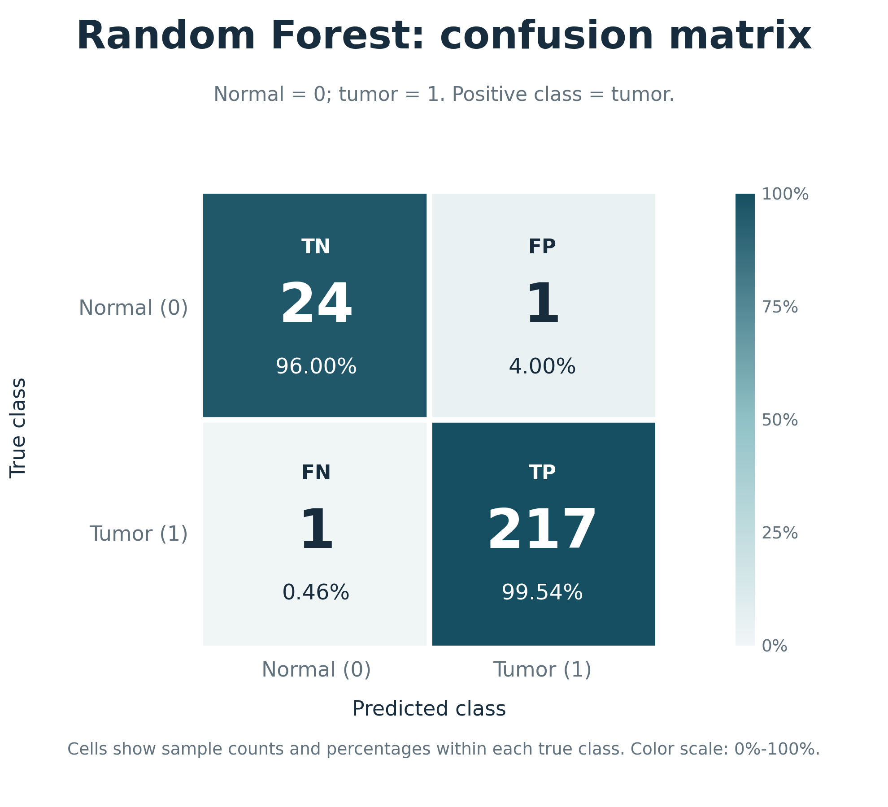
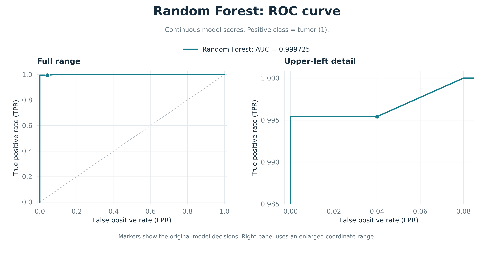
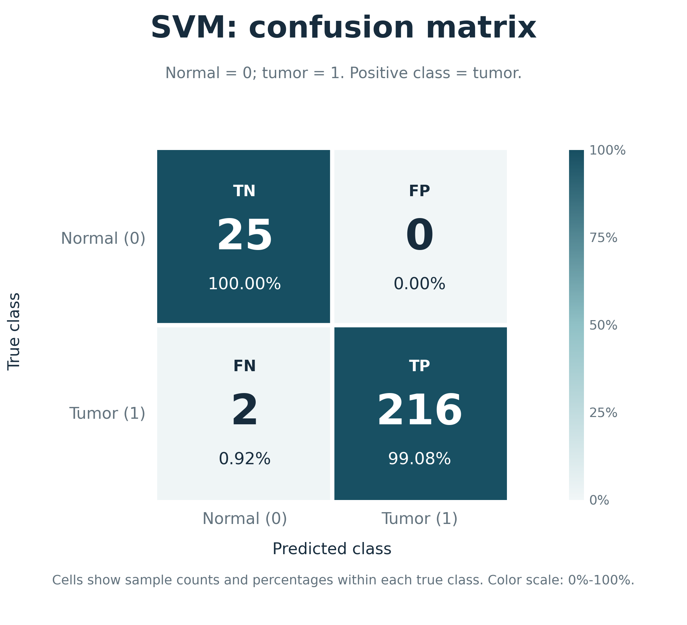
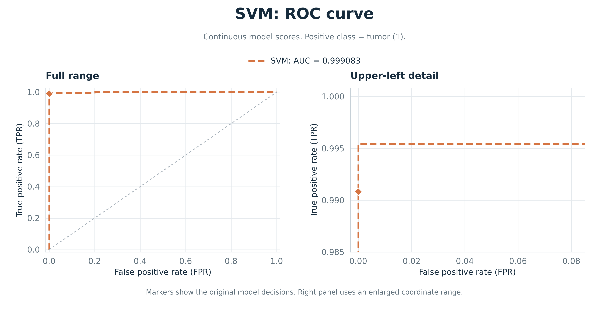
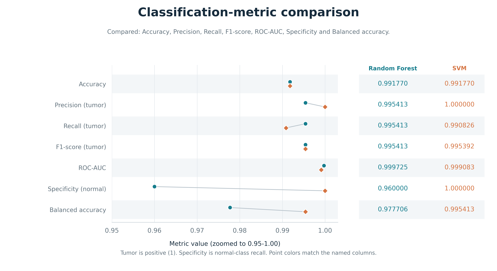
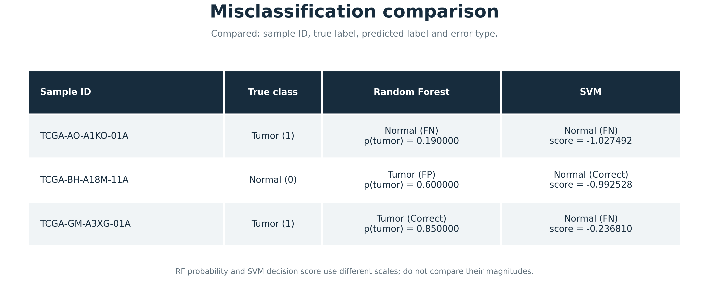

# 随机森林与 SVM 的分类结果

## 数据和评价口径

评估使用项目中已经保存的测试集预测。随机森林读取 `results/rf_test_manual/predictions.csv`，SVM 读取 `results/svm/test_predictions.csv`。随机森林的这份预测还与 `results/rf_reproduce_v1_test/predictions.csv` 逐样本比较过，243 个样本的标签、预测和概率一致。

计算指标前，先按样本 ID 将两份预测与 `test_data.npz`、`sample_manifest.tsv` 对齐。两模型均有 243 个测试样本，其中肿瘤 218 个，正常组织 25 个。所有 ID 唯一，样本集合和真实标签一致。训练集有 976 个样本，来自 877 位患者；测试集来自 218 位患者，训练、测试两侧没有患者重叠。

肿瘤是正类，标签为 1；正常组织是负类，标签为 0。Precision、Recall 和 F1 都按肿瘤正类计算。混淆矩阵的行表示真实类别，列表示预测类别，类别顺序均为正常、肿瘤。

| 计数 | 含义 |
|---|---|
| TP | 肿瘤样本被正确判为肿瘤 |
| TN | 正常样本被正确判为正常 |
| FP | 正常样本被误判为肿瘤 |
| FN | 肿瘤样本被误判为正常 |

评价指标由 scikit-learn 计算，口径如下。

| 指标 | 计算方法 |
|---|---|
| Accuracy | (TP+TN)/(TP+TN+FP+FN) |
| Precision | TP/(TP+FP) |
| Recall | TP/(TP+FN) |
| F1-score | 2TP/(2TP+FP+FN) |
| Specificity | TN/(TN+FP)，即正常类召回率 |
| Balanced accuracy | (Recall+Specificity)/2 |
| ROC-AUC | 根据真实标签和连续预测分数计算 ROC 曲线下面积 |

随机森林的 AUC 使用肿瘤概率 `tumor_probability`，SVM 使用决策函数得分 `decision_score`。两种分数都是越大越倾向肿瘤，但 SVM 得分不是概率，不能直接比较两列分数的大小。Accuracy 等指标沿用原模型给出的预测标签，没有根据测试成绩更换阈值或调整参数。

## 随机森林结果

随机森林判对了 241 个样本。25 个正常样本中有 24 个判对，1 个被判为肿瘤；218 个肿瘤样本中有 217 个判对，1 个被判为正常。因此，TN=24、FP=1、FN=1、TP=217。



混淆矩阵同时标注数量和真实类别内的比例，正常类与肿瘤类的识别情况可以分别查看。随机森林的肿瘤召回率为 99.54%，正常类特异度为 96%。



随机森林的 ROC-AUC 为 0.999725。左图显示完整坐标范围，右图放大左上角，圆点对应原模型的分类工作点。

## SVM 结果

SVM 同样判对 241 个样本。25 个正常样本全部判对，218 个肿瘤样本中有 216 个判对，2 个被判为正常。因此，TN=25、FP=0、FN=2、TP=216。



SVM 的肿瘤召回率为 99.08%，正常类特异度为 100%。本次没有假阳性，所以肿瘤 Precision 也为 1。



SVM 的 ROC-AUC 为 0.999083。菱形标记表示原模型的零决策边界所对应的工作点，右侧局部图只放大显示，没有用来选择新阈值。

## 两模型对比

对比使用同一批测试样本。两模型都选取 100 个基因作为输入；随机森林使用 200 棵树，SVM 使用 RBF 核，C=0.1、gamma=0.001。这里核对的是特征数量，不据此断言两份基因名单完全相同。基因是模型输入特征，Accuracy、AUC 等则是评价指标。

| 指标 | 随机森林 | SVM |
|---|---:|---:|
| Accuracy | 0.991770 | 0.991770 |
| Precision（肿瘤） | 0.995413 | 1.000000 |
| Recall（肿瘤） | 0.995413 | 0.990826 |
| F1-score（肿瘤） | 0.995413 | 0.995392 |
| ROC-AUC | 0.999725 | 0.999083 |
| Specificity（正常） | 0.960000 | 1.000000 |
| Balanced accuracy | 0.977706 | 0.995413 |



指标图逐行标出比较内容，并列出六位小数。横轴明确标注为局部放大范围，方便查看接近 1 的指标。

两模型准确率相同，都是 241/243=99.18%，但错误类型不同。随机森林少漏判一个肿瘤样本，SVM 则少误判一个正常样本。测试集中肿瘤占 89.71%，即使把所有样本都判为肿瘤，准确率也有 89.71%，因此只看准确率容易忽略正常类的表现。SVM 的平衡准确率更高，主要来自正常类识别率的提升。

随机森林的 AUC 高约 0.000642，肿瘤召回率也略高。两者 F1 仅相差约 0.000021，不能把这点差距说成明显优势。AUC 衡量分数排序，混淆矩阵反映原分类规则下的判断结果，所以 AUC 更高不意味着其他指标也全部更高。

## 误分类样本

两模型合计涉及三个不同的误分类样本，其中一个被同时判错。

| 样本 ID | 真实类别 | 随机森林 | SVM |
|---|---|---|---|
| TCGA-BH-A18M-11A | 正常 | 肿瘤，FP；概率 0.600000 | 正常；得分 -0.992528 |
| TCGA-GM-A3XG-01A | 肿瘤 | 肿瘤；概率 0.850000 | 正常，FN；得分 -0.236810 |
| TCGA-AO-A1KO-01A | 肿瘤 | 正常，FN；概率 0.190000 | 正常，FN；得分 -1.027492 |



前两个样本分别被其中一个模型判错，说明相同的错误总数不对应相同的分类边界。`TCGA-AO-A1KO-01A` 被两个模型同时误判，后续可以结合表达数据和临床注释检查原因。现有预测表不足以确定具体原因，该样本也没有从测试集中删除。

## 结论和限制

如果同时关注正常组织和肿瘤组织的识别，SVM 在这次划分上更均衡；如果更看重减少肿瘤漏判，随机森林本次少出现一个假阴性，AUC 也略高。两者没有在全部指标上分出一致的高下。

正常样本只有 25 个，每错一个就会使特异度下降 4 个百分点。243 个组织样本来自 218 位患者，也不宜把所有样本都视为相互独立。本次没有做显著性检验或外部队列验证，不能据此推断模型在其他数据上的差异。

## 运行与环境

在项目根目录执行。建议使用独立的 Python 3.12 环境，按 `requirements-evaluation.txt` 安装依赖。

```bat
python -m pip install -r requirements-evaluation.txt
python -m src.evaluate --output-dir results/check_metrics
python -m src.visualize --output-dir results/check_figures
python -m unittest discover -s tests -v
```

评估命令写入指定目录。绘图命令默认读取 `results/metrics.csv` 和 `results/evaluation/aligned_predictions.csv`；若要绘制刚才重算的结果，使用 `python -m src.visualize --results-dir results/check_metrics --output-dir results/check_figures_2`。

实测环境为 Python 3.12.14、NumPy 2.3.5、Pandas 2.2.3、SciPy 1.17.0、scikit-learn 1.8.0、Matplotlib 3.10.8。测试覆盖指标核对、样本对齐、标签冲突、无效分数、患者重叠和输出目录保护，共 28 项通过。

指标原始数值保存在 `results/metrics.csv`。输入文件摘要、环境和计算口径保存在 `results/evaluation/audit.json`，图像文件摘要保存在 `results/model_views/display_audit.json`，便于追溯结果来源。
