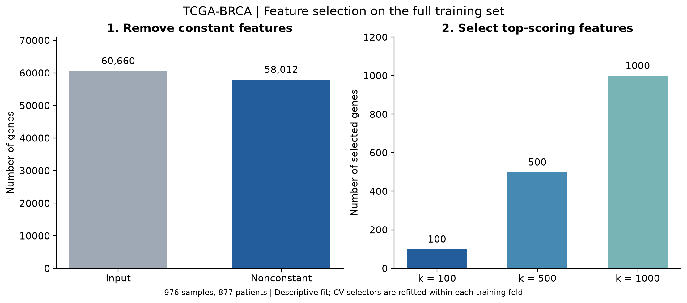
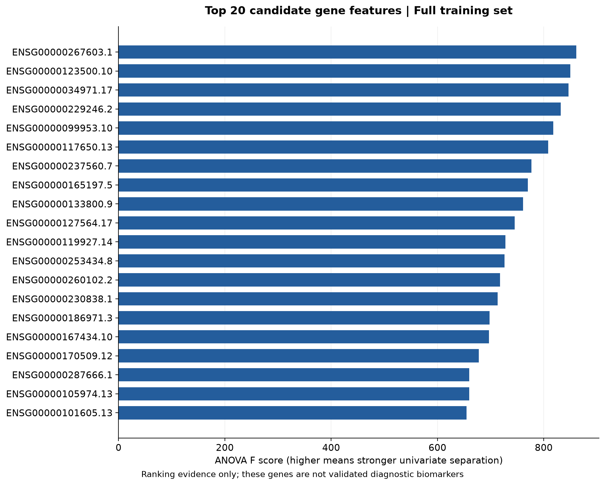
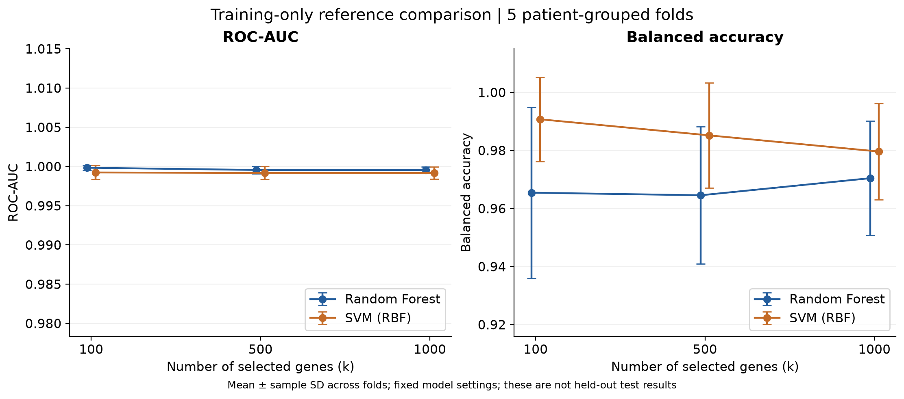
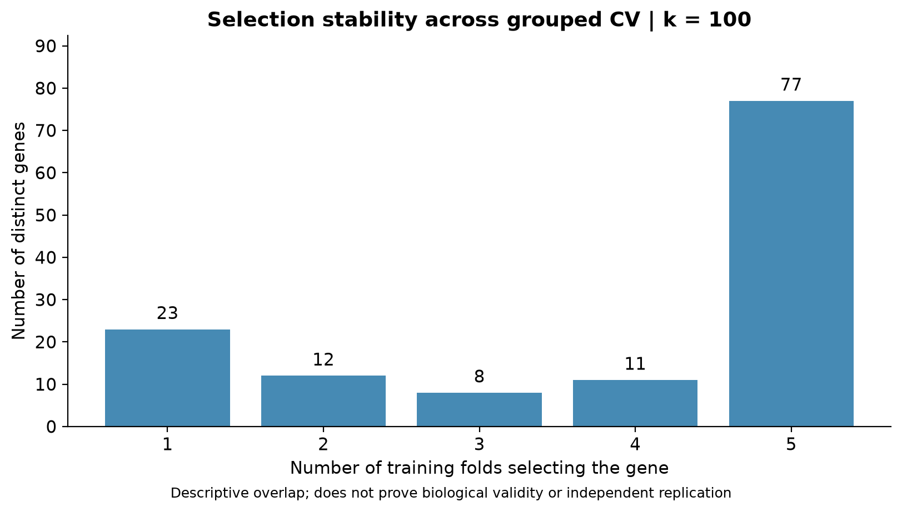

# TCGA-BRCA RNA-seq 特征选择方法与实验结果

日期：2026-10-31。角色：D。任务依据：[issue #5](https://github.com/yz-Yezi-Genm/Bioinformatics-Disease-Classification/issues/5)。

## 1. 目的与范围

从 C 已处理的 TCGA-BRCA RNA-seq 表达矩阵中选择具有分类区分能力的基因，为肿瘤与正常组织分类的随机森林和 SVM 提供可复用模块。交付包含三档特征数量的真实筛选结果、统计表、图表和训练集内部参考比较。

特征选择模块和 D 的结果分析已完成。E/F 正式训练流程的集成确认、模型最终调参及 G 的独立测试评价仍由相应成员完成。本文中的模型分数来自 D 为比较特征数量运行的固定模型参考实验，不代表小组最终测试结果。

## 2. 输入数据与核查

C 的交付包：`TCGA-BRCA-experiment1-preprocessed-20261029-v2.zip`。

压缩包 SHA256：`7cb784fe1ea37270599feaabe65f9634c7a277b8f16812d610e5bb597ba75ba4`。

| 项目 | 训练集 | 原有保留测试集 |
|---|---:|---:|
| 样本数 | 976 | 243 |
| 正常组织，0 | 88 | 25 |
| 原发肿瘤，1 | 888 | 218 |
| 患者数 | 877 | 218 |
| 基因数 | 60,660 | 60,660 |

测试集描述来自前期交接核查；正式筛选和参考实验没有加载 `test_data.npz`。C 使用按患者分组的外部分割，训练与测试患者交集为 0，继续沿用该分割。

文件含义：

- `train_data.npz` 的 `X` 为“样本 × 基因”，原始输出 dtype 为 float32；`y` 为 uint8；`sample_id` 为样本条码。
- `feature_ids.tsv` 用连续的 `feature_index` 映射矩阵列到 Ensembl ID，保留版本后缀。
- `sample_manifest.tsv` 提供样本、患者、标签及划分；代码按 sample_id 对齐，不假定行顺序相同。
- `audit.json` 提供版本与校验值。加载训练输入时核对训练 NPZ、特征表和样本清单的 SHA256。

本次实际检查了训练表达值：全部有限、无负值，范围为 0 至 22.87331199645996；恒定特征数重算为 2,648，与 C 记录一致。样本 ID、标签、患者分组和基因列对应关系均通过核查。

C 的 README 将表达值说明为 `log2(count+1)`。本任务沿用该尺度，既不再次取 log，也不还原取整用于 DESeq2。该数值含义依赖 C/A 的来源说明，本次未重新下载源矩阵进行独立验证。

审计中原始尺寸字段写作 `[60660,1227]`，而 README 描述为 60,660 个基因 × 1,226 个表达样本，该字段可能包括基因 ID 列。输出 NPZ 的维度已确认一致；原始字段口径仍可由 C 澄清。文件一致性核查不能替代对原始临床标签的独立核验。

## 3. 方法

### 3.1 恒定特征过滤

使用 `VarianceThreshold(threshold=0.0)`，只去除当前训练数据中所有样本取值相同的基因。该步骤不使用标签。完整训练集过滤后为：

`60,660 − 2,648 = 58,012 个非恒定基因`。

在不同交叉验证训练折内重新计算；本次各折去除常量的数量为 2,700、2,700、2,744、2,705、2,701，不能把完整训练集的掩码预先用于交叉验证。

### 3.2 单变量评分与 Top-k 筛选

对剩余基因使用 `SelectKBest(f_classif)`。ANOVA F 得分比较两类间的均值差异与类内变化，较高分值表示较强的单变量组间区分。计算转换为 float64，以减少高维求和与方差计算中的数值误差。

候选 k 为 100、500、1000。特征筛选时不把 patient_id、sample_id、标签或临床类型拼进表达矩阵。最终输出列维持原始基因列顺序，导出表中的 rank 单独表示得分排名。

代码检查 k 是否超出过滤后特征数、是否包含无效分数；正无穷 F 分数可表示完全分离，代码保留并记录。本次三个候选配置未发现无穷分数。SelectKBest 的并列得分处理由 sklearn 实现，复现应采用锁定依赖版本，不把并列名次理解为严格的生物学优先顺序。

### 3.3 适用条件与局限

该方法适用于当前连续表达特征和二分类标签，易于复现和集成。它逐个基因评分，不能直接发现只在组合中起作用的特征，也不能保证去除相关基因冗余。

导出的 `pvalue_nominal` 是未做多重比较校正的名义 p 值。样本不平衡、类内分布／方差以及同一患者重复样本会影响其统计解释。本实验把 F 得分用于预测特征排序，不以名义 p 值宣称差异表达显著性或生物标志物有效性。无需依据这些值进行独立的临床判断。

## 4. 防止数据泄漏与交叉验证

训练样本 976 个来自 877 位患者，因此内部验证继续按 patient_id 分组。使用 `StratifiedGroupKFold(n_splits=5, shuffle=True, random_state=20261031)`，各折患者无交集，训练和验证部分均包含正常与肿瘤样本。

| 折 | 训练样本 | 验证样本 | 验证正常 | 验证肿瘤 | 患者交集 |
|---|---:|---:|---:|---:|---:|
| 1 | 780 | 196 | 18 | 178 | 0 |
| 2 | 780 | 196 | 18 | 178 | 0 |
| 3 | 782 | 194 | 17 | 177 | 0 |
| 4 | 781 | 195 | 18 | 177 | 0 |
| 5 | 781 | 195 | 17 | 178 | 0 |

每个模型、k、折都创建新的 Pipeline，并在当前训练折拟合选择器。验证折只应用已拟合规则。SVM 的标准化同样在 Pipeline 内完成。完整训练集导出的候选基因列表只用于描述性分析和完整训练拟合后的交接，不能提前套用到交叉验证中。

测试集不参与方法、k、模型超参数或阈值选择。最终测试由 E/F/G 在方案冻结后完成。本次没有测试集性能指标，也没有因测试分数调整方案。

## 5. 真实筛选结果

| k | 输入基因 | 去除恒定特征 | 非恒定基因 | 输出基因 | 相对输入保留比例 |
|---:|---:|---:|---:|---:|---:|
| 100 | 60,660 | 2,648 | 58,012 | 100 | 0.1649% |
| 500 | 60,660 | 2,648 | 58,012 | 500 | 0.8243% |
| 1000 | 60,660 | 2,648 | 58,012 | 1000 | 1.6485% |

结果文件为 `selected_features_k100.csv`、`selected_features_k500.csv`、`selected_features_k1000.csv`，对应完整训练集的描述性拟合。`feature_scores.csv` 保存所有原始基因的评分与方差过滤状态；被过滤的常量基因没有 F 分数，空值不代表零分。

基因表关键字段：

| 字段 | 含义 |
|---|---|
| feature_index | 原始 60,660 列矩阵中的零基列索引 |
| ensembl_id | 带版本后缀的 Ensembl ID |
| score | ANOVA F 得分 |
| pvalue_nominal | 未校正名义 p 值，不用于生物学显著性宣称 |
| rank | 按 F 得分降序的排名，并列采用最小名次 |
| passed_variance / selected | 是否通过方差过滤／入选当前列表 |
| output_column | 变换后矩阵的零基列位置 |



图 1：完整训练集上的特征数量变化。左右面板使用各自的线性纵轴。



图 2：完整训练集 F 得分最高的 20 个基因。最高得分的 ID 为 ENSG00000267603.1；本图只描述统计筛选结果，不构成生物标志物验证。

## 6. 训练集内部 RF/SVM 参考实验

参考设置事先固定，所有 k 使用相同的患者验证折：

- RF：200 棵树，`max_features='sqrt'`，`class_weight='balanced_subsample'`，`random_state=20261031`，2 个并行工作线程。
- SVM：RBF 核，`C=1.0`，`gamma='scale'`，`class_weight='balanced'`；选完特征后使用 StandardScaler。
- ROC-AUC 使用 RF 的肿瘤类概率或 SVM 的 decision_function；分类指标使用模型默认决策规则。没有调整分类阈值。
- 外层按折顺序执行，数值线程数限制为 2。依赖版本在锁定文件和 metadata 中。

以下为五折均值 ± 样本标准差，标准差不是置信区间，也不是独立患者外部重复实验误差。

| 模型 | k | 验证 ROC-AUC | Balanced accuracy | 肿瘤类 F1 | 正常类召回／特异度 |
|---|---:|---:|---:|---:|---:|
| RF | 100 | 0.999844 ± 0.000349 | 0.965451 | 0.996078 | 0.932026 |
| RF | 500 | 0.999559 ± 0.000472 | 0.964563 | 0.995509 | 0.931373 |
| RF | 1000 | 0.999556 ± 0.000423 | 0.970445 | 0.996069 | 0.943137 |
| SVM | 100 | 0.999240 ± 0.000902 | 0.990744 | 0.996050 | 0.988235 |
| SVM | 500 | 0.999177 ± 0.000816 | 0.985191 | 0.995487 | 0.977124 |
| SVM | 1000 | 0.999174 ± 0.000763 | 0.979636 | 0.994923 | 0.966013 |

其他指标的标准差、肿瘤类召回和耗时见 `k_comparison.csv`；每折结果见 `cv_fold_metrics.csv`，逐样本折外预测见 `cv_predictions.csv`。

预先设定的 k 规则：选择平均验证 AUC 距该模型最佳平均值不超过 0.001 的最小 k。这是便于交接的实用规则，不是显著性检验。按该规则两个参考模型均选择 k=100，且本次 k=100 也分别获得最高平均 AUC。

因此建议 E/F 先从 k=100 接入。RF 的 k=1000 在 balanced accuracy 和正常类召回上略高，不能宣称 k=100 在所有指标上全面最好。三个 k 的 AUC 差异很小、接近上限，不能据此断言某个设置具有显著优势。若 E/F 改变模型参数或主要评价指标，应重新在训练集内部验证选择。

`selected_features_rf_reference.csv` 与 `selected_features_svm_reference.csv` 为参考 k 确定后在完整训练集拟合的名单；本次两份均对应 k=100，内容相同。它们没有被标记为小组正式冻结的最终名单。

本次没有运行 58,012 特征的“仅去常量”模型基线，因此只能比较 100／500／1000 三种设置，不能宣称相对不筛选提高了分类性能。训练集内部 CV 已用于选择 k，报告分数不是无偏最终性能估计；独立保留测试与外部数据验证仍然必要。



图 3：训练集分组交叉验证的均值与标准差。误差棒是均值 ± 标准差，可能超出指标理论边界，不表示实际观测分数超过 1。

## 7. 跨折选择稳定性

| k | 五折均入选的基因数 | 五折并集基因数 | 两两 Jaccard 均值 |
|---:|---:|---:|---:|
| 100 | 77 | 131 | 0.773627 |
| 500 | 395 | 611 | 0.811403 |
| 1000 | 863 | 1149 | 0.870135 |

100 基因配置下，五折都入选的基因为 77 个，其余候选在不同折之间有所变化。稳定性只描述这一次数据划分中的重合程度，不是生物学独立验证，也没有用于重新修改 k 或构造共识名单参与 CV。



图 4：k=100 时，基因在五个训练折中的入选频次。每一折只使用该折训练数据筛选。

## 8. 复现与 E/F 接入

在项目根目录执行；使用 Python 3.12，具体实测版本为 3.12.14，NumPy 2.5.4、SciPy 1.18.1、scikit-learn 1.9.1、pandas 3.1.0、Matplotlib 3.11.2。完整依赖锁定在 `requirements-feature-selection.txt`。

```powershell
python -m venv .venv
& .\.venv\Scripts\python.exe -m pip install -r requirements-feature-selection.txt
& .\.venv\Scripts\python.exe scripts/prepare_data.py --archive "你的数据包完整路径.zip"
& .\.venv\Scripts\python.exe -m src.feature_selection --data-dir data/processed/tcga_brca_20261029_v2 --ks 100 500 1000
& .\.venv\Scripts\python.exe -m scripts.run_reference_cv --data-dir data/processed/tcga_brca_20261029_v2 --ks 100 500 1000 --jobs 2
& .\.venv\Scripts\python.exe -m scripts.make_figures
& .\.venv\Scripts\python.exe -m scripts.verify_results --data-dir data/processed/tcga_brca_20261029_v2
```

单独运行筛选无需模型训练；参考 CV、图表和验证分别有独立入口。输入目录也可以指定为团队已有的 C 数据目录，只要包含同一版本的六个文件。输出默认在 `results/feature_selection/` 和 `results/figures/`。相同命令会覆盖相应结果文件，保留历史实验请使用独立输出目录。

E/F 创建新选择器的核心用法：

```python
from src.feature_selection import create_selector
from sklearn.pipeline import Pipeline
from sklearn.preprocessing import StandardScaler
from sklearn.svm import SVC

pipeline = Pipeline([
    ("select", create_selector(k=100)),
    ("scale", StandardScaler()),
    ("classifier", SVC(C=1.0, kernel="rbf", gamma="scale", class_weight="balanced")),
])
# 每折用 pipeline 的新克隆在该训练折 fit，验证折只预测。
# 完整的 RF/SVM 与分组验证示例：examples/pipeline_integration.py。
```

NumPy 数组不自带列名，调用方必须保证特征顺序完全相同；代码只能检查列数。若 fit 使用 DataFrame，transform 必须传入相同列名与顺序的 DataFrame，代码会拒绝错序或未命名的输入。不要把按 rank 排序的基因列表误当成输出矩阵列序；使用 `output_column` 或 `get_support(indices=True)`。

### 参数

- `create_selector(k=...)`：返回尚未拟合的 GeneSelector，k 可为正整数或 `'all'`。正式候选比较为 100／500／1000。
- `GeneSelector(variance_threshold=...)`：默认 0；本实验未调整该值。
- `--data-dir`：C 的 v2 解压目录。
- `--output-dir`：筛选或 CV 表格的输出目录。
- `--ks`：候选保留数量，以空格分隔。
- `--jobs`：RF 工作线程数；默认 2，外层 CV 顺序执行。
- 绘图 `--results-dir` 和 `--figures-dir`：分别指定表格输入与图片输出目录。

## 9. 验证与交付状态

`tests/test_feature_selection.py` 覆盖原始列映射、transform 不重新拟合、DataFrame 错序拒绝、无效 k 与标签、非有限数据、失败 refit 清理、sklearn 克隆与真实分组 CV Pipeline、复现与 all 模式。

`scripts/verify_results.py` 在真实数据上重新检查三份基因列表与 fresh fit 一致、输出列序正确、患者折无交集、30 次模型／k／折记录齐全，每个样本在每个模型／k 下恰有一次折外预测，且可以由预测重算各折 AUC／balanced accuracy／F1，并复算汇总均值／标准差和参考 k 选择。

验证记录见 `results/feature_selection/verification.json`。本包不保存大型表达矩阵和训练模型权重；最终模型文件由 E/F 负责。

## 10. 参考资料

- [VarianceThreshold](https://scikit-learn.org/stable/modules/generated/sklearn.feature_selection.VarianceThreshold.html)
- [SelectKBest](https://scikit-learn.org/stable/modules/generated/sklearn.feature_selection.SelectKBest.html)
- [StratifiedGroupKFold](https://scikit-learn.org/stable/modules/generated/sklearn.model_selection.StratifiedGroupKFold.html)
- [scikit-learn：数据泄漏与正确验证](https://scikit-learn.org/stable/common_pitfalls.html)
